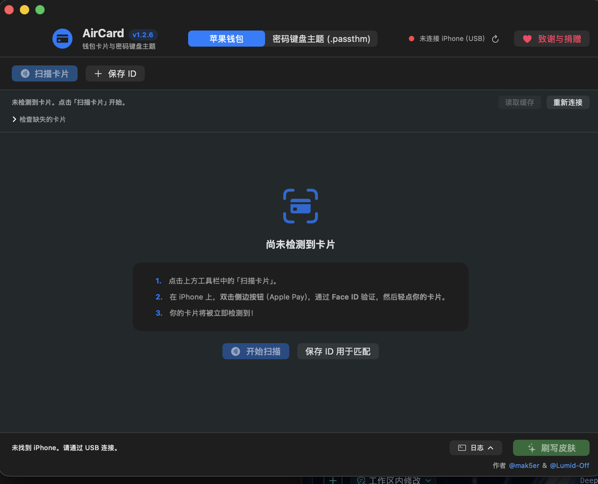
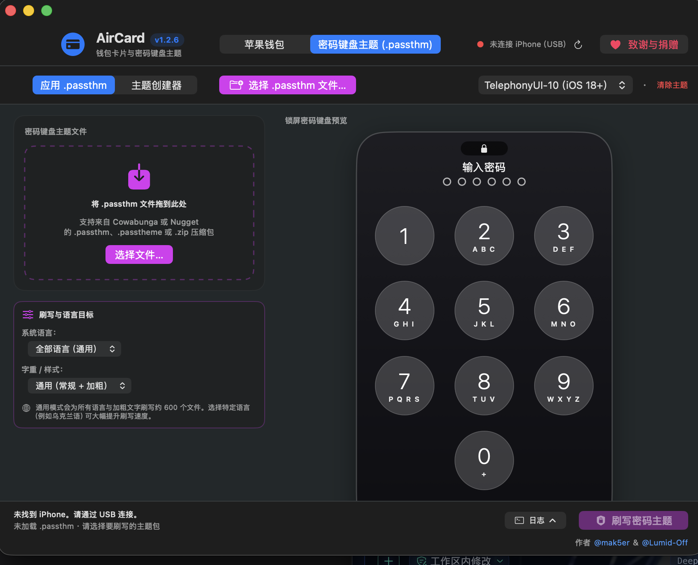

# 用 DeepSeek 汉化 AirCard

> **AirCard 简体中文版** · 基于官方 [Mak5er/AirCard](https://github.com/Mak5er/AirCard) **v1.2.6** 全量汉化
> 翻译与工程化改造由 **DeepSeek** 协助完成 · 原作者 [@mak5er](https://github.com/Mak5er) & [@Lumid-Off](https://github.com/Lumid-Off)

AirCard 是一个 macOS 小工具：通过 `airlift`（AirTraffic 同步逃逸）给 iPhone 的 Apple 钱包卡面换皮肤，并刷写锁屏密码键盘主题（`.passthm`）—— **无需越狱**。

本仓库是它的**非官方简体中文汉化版**，功能与官方 v1.2.6 保持一致，只做界面本地化，不改变任何设备写入逻辑。

---

## 截图

| 钱包卡片 | 密码键盘主题 |
| --- | --- |
|  |  |

| 主题创建器 | 单独按键编辑 |
| --- | --- |
|  |  |

| 首次启动 |
| --- |
|  |

## 功能特性

- **完整中文界面**：约 250 条静态文案 + 60 条动态消息规则，覆盖主窗口、钱包卡片、密码键盘主题、主题创建器、设备连接、诊断、捐赠页、状态栏、错误提示与文件选择面板。
- **与官方 v1.2.6 功能一致**：没有删减功能，也没有额外网络请求或遥测。
- **通用二进制**：同时支持 Apple Silicon 与 Intel Mac，最低 macOS 14。
- **可复现构建**：附带完整构建脚本与文案生成器，任何人都能从源码编译。

## 下载与安装

1. 前往 [Releases](../../releases/latest) 下载 `AirCard-1.2.6-zh.dmg`。
2. 打开 DMG，把 **AirCard** 拖入「应用程序」。
3. **首次启动**：由于是本地构建（临时签名），macOS 可能拦截。请：
   - 在「应用程序」中 **右键 AirCard → 打开 → 再次点「打开」**；或
   - 终端执行：`sudo xattr -cr /Applications/AirCard.app`

> 已有官方版可直接覆盖安装：Bundle ID 相同（`com.mak5er.aircard`），偏好设置会保留。

## 汉化范围

| 已汉化 | 未汉化 |
| --- | --- |
| 主窗口、标签页、工具栏 | 活动日志中底层 Python 后端输出的技术行 |
| 钱包卡片扫描与皮肤刷写 | 设备原始名称（如 `Maksym's iPhone`） |
| 密码键盘主题（应用 / 创建器） | 卡面哈希、文件路径等标识符 |
| 设备连接、诊断面板 | — |
| 欢迎页、捐赠页、错误弹窗 | — |

活动日志保留英文是刻意为之：它主要用于排错，技术术语与日志原文一一对应更利于检索。

## 从源码构建

**环境要求**：macOS 14+，Xcode Command Line Tools（`xcode-select --install`）。

```bash
git clone https://github.com/<your-name>/AirCard-zh.git
cd AirCard-zh
./build_zh.sh
open build/AirCard.app        # 直接运行
# 安装包产物：build/AirCard-zh.dmg
```

`build_zh.sh` 会自动完成：

1. 用 `clang` 编译通用架构的 `device_helper` / `airtraffic_host`
2. 组装 `.app` 目录并写入 `Info.plist`（`CFBundleDevelopmentRegion = zh-Hans`）
3. 把 `Localization/zh-Hans.lproj/Localizable.strings` 打进 `Resources`
4. 编译 SwiftUI 主程序（arm64 + x86_64，自动匹配 SDK）
5. 临时签名并生成 DMG

## 汉化是怎么做的

没有改二进制，也没有反编译。全部基于官方源码 + 标准 macOS 本地化机制：

1. **标准 `.lproj` 本地化**
   `Localization/zh-Hans.lproj/Localizable.strings` 以英文原文为键。SwiftUI 的 `Text("...")`、`Button("...")`、`Section("...")` 会自动查表，无需改动。

2. **插值字符串用格式键**
   `Text("\(n) items")` 在 SwiftUI 中会生成 `%lld items` 这样的格式键，因此字符串表里补充了
   `"%lld of 10 keys configured" = "已配置 %lld / 10 个按键";` 这类条目。

3. **运行时拼接的字符串用 `tr()`**
   `Text(vm.statusText)`、`Text(cond ? "A" : "B")` 这类在运行时才确定的字符串不会自动本地化。
   `AirCardApp.swift` 顶部新增了 `tr(_:)`：
   - 先按精确英文查 `Localizable.strings`；
   - 未命中时再按 60 条正则规则翻译带变量的句子，例如
     `Connected to <设备名>` → `已连接到 <设备名>`。

4. **文案生成器**
   `tools/gen_strings.py` 维护全部译文并生成 `.strings` 文件，方便后续版本增量更新。

## 目录结构

```
AirCard-zh/
├── AirCardApp.swift                 # 主界面（含 tr() 本地化辅助）
├── Sources/                         # Swift / Objective-C 源码
├── Localization/zh-Hans.lproj/      # 简体中文本地化表
├── build_zh.sh                      # 中文版构建脚本
├── tools/gen_strings.py             # 文案生成器
├── screenshots/                     # README 截图
├── docs/                            # 官方使用文档
├── assets/  dmg_assets/             # 图标与安装包素材
├── LICENSE                          # MIT（保留原作者版权）
└── NOTICE.md                        # 来源与致谢
```

## 与原版的差异

| 文件 | 改动 |
| --- | --- |
| `Info.plist`（构建时生成） | `CFBundleDevelopmentRegion` 改为 `zh-Hans`，只打包 `zh-Hans` 本地化 |
| `AirCardApp.swift` | 新增 `tr()` 本地化辅助函数；约 20 处动态文本包裹 `tr()` |
| `Sources/WalletDiagnosticsView.swift` | 4 处动态文本包裹 `tr()` |
| `Localization/zh-Hans.lproj/Localizable.strings` | 新增 249 条中文文案 |
| `build.sh` → `build_zh.sh` | 打包本地化资源、自动匹配 SDK、指定模块缓存 |
| 其余源码 | 与官方 v1.2.6 一致 |

## 致谢

- 原作者：[**Mak5er / Maksym Reva**](https://github.com/Mak5er) 与 [**Lumid-Off**](https://github.com/Lumid-Off)
- 原项目：[https://github.com/Mak5er/AirCard](https://github.com/Mak5er/AirCard)（MIT）
- 核心漏洞利用：`airlift`（AirTraffic 同步逃逸）
- 汉化：由 **DeepSeek** 协助完成翻译、源码定位、构建适配与逐页验证

如果这个汉化版帮到了你，欢迎给本项目点 Star，也请去原项目支持原作者。

## 许可证

本项目沿用原项目的 **MIT License**，完整保留原作者版权声明，详见 [LICENSE](LICENSE)。
新增的汉化文案与构建脚本同样以 MIT 发布。

## 免责声明

- 本项目是**非官方汉化**，与 Mak5er、Apple 均无隶属关系。
- AirCard 会通过 `airlift` 修改 iPhone 上的钱包缓存文件，存在一定风险，请自行评估并承担后果。
- 请仅用于个人学习与设备美化，遵守当地法律法规。
